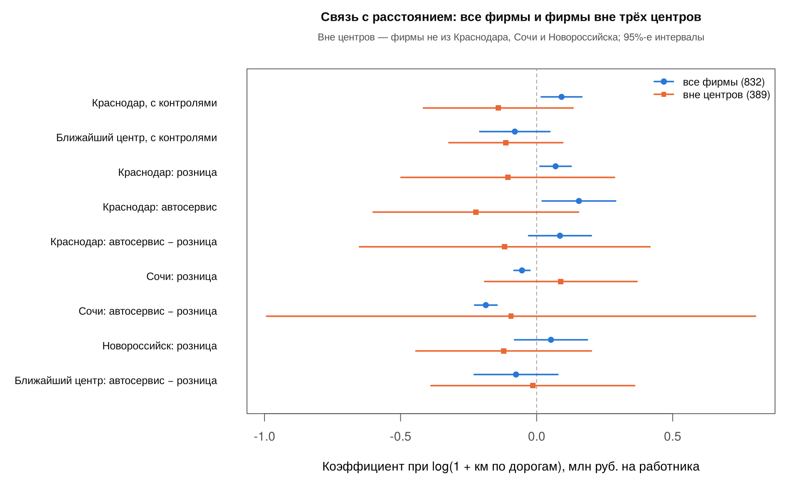

# Регрессии по фирмам вне центров

## Зачем

В общей выборке 443 из 832 фирм (53%) зарегистрированы в самих Краснодаре, Сочи и Новороссийске, где расстояние до своего центра равно нулю. Между нулём и ближайшим нецентральным пунктом фирм нет: вне центров дорожное расстояние до Краснодара начинается с 13 км, то есть log(1 + км) ≥ 2,6, медиана — 5,0. Поэтому коэффициент при log(1 + км) на полной выборке во многом сравнивает **«фирмы в центре против остальных»**, а не показывает, как результат меняется **по мере удаления**.

Чтобы разделить эти два вопроса, связь оценена:

1. только по фирмам **вне трёх центров**;
2. на полной выборке с **индикаторами центров** (`in_krasnodar`, `in_sochi`, `in_novorossiysk`). Индикаторы «забирают» отличие фирм в центрах, и коэффициент расстояния опирается только на нецентральные пункты.

Скрипт: [`scripts/regression_profit_noncenter.R`](../scripts/regression_profit_noncenter.R). Зависимая переменная, спецификации и кластерные ошибки CR1 — как в [дорожных моделях](regression_profit_road_RU.md); каждая модель оценена с прямым и дорожным расстоянием. Запуск из корня проекта после `regression_profit_road.R`:

```r
source('scripts/regression_profit_noncenter.R')
```

## Выборка

| Выборка | Фирм | Пунктов |
|---|---|---|
| Общая (как в дорожных моделях) | 832 | 143 |
| исключены: Краснодар / Сочи / Новороссийск | 238 / 175 / 30 | 3 |
| **Вне центров** | **389** (284 розницы, 105 автосервисов) | **140** |
| Вне центров без 1% хвостов (от −2,44 до 7,74 млн руб.) | 381 | 140 |
| Вне центров без самой влиятельной фирмы | 388 | 140 |

В 81 из 140 пунктов зарегистрирована одна фирма. Обе самые экстремальные фирмы полной выборки (+55 и −32 млн руб. на работника) находятся в центрах и сюда не попадают. Самая влиятельная фирма вне центров — продуктовый магазин в Геленджике, 27 млн руб. на работника.

Вне центров расстояние до Краснодара почти не связано с размером пункта (корреляция log-величин 0,10, на полной выборке −0,56), поэтому эффекты расстояния и населения здесь не смешиваются.

## Результаты

Коэффициент при log(1 + км по дорогам), млн руб. на работника; в скобках 95%-й интервал.

| Оценка | Все фирмы | С индикаторами центров | Вне центров | Вне центров, без 1% хвостов |
|---|---|---|---|---|
| Краснодар, с контролями | 0,092 [0,017; 0,166] | −0,106 [−0,393; 0,181] | −0,141 [−0,416; 0,134] | −0,036 [−0,126; 0,055] |
| То же, по прямой | 0,094 [0,008; 0,179] | −0,180 [−0,447; 0,087] | −0,209 [−0,473; 0,055] | −0,046 [−0,137; 0,044] |
| Ближайший центр, с контролями | −0,080 [−0,209; 0,049] | — | −0,113 [−0,322; 0,096] | — |
| Краснодар: автосервис − розница | 0,086 [−0,029; 0,201] | — | −0,117 [−0,651; 0,416] | −0,037 [−0,331; 0,257] |
| Сочи: автосервис − розница | −0,187 [−0,228; −0,145] | — | −0,094 [−0,993; 0,804] | 0,357 [−0,230; 0,945] |

Полные таблицы: [`results/profit_noncenter_comparison.csv`](../results/profit_noncenter_comparison.csv), [`results/profit_noncenter_coefficients.csv`](../results/profit_noncenter_coefficients.csv), [`results/profit_noncenter_centers.csv`](../results/profit_noncenter_centers.csv); график — [`figures/11_noncenter_vs_full.png`](../figures/11_noncenter_vs_full.png).



**Что видно:**

1. **Знак связи с расстоянием до Краснодара меняется.** На полной выборке коэффициент положительный, интервал не включает ноль. Вне центров и на полной выборке с индикаторами центров он отрицательный (−0,14 и −0,11 по дорогам), интервалы включают ноль. Обе версии дают близкий результат — значит, положительная оценка на полной выборке создаётся отличием фирм в центрах от остальных, а не плавным изменением с расстоянием.
2. **Центры отличаются друг от друга.** В модели с индикаторами фирмы Краснодара в среднем ниже периферии на 0,64 млн руб. на работника ([−1,80; 0,53]), фирмы Сочи выше на 0,62 ([−0,02; 1,26]). При общем нуле расстояния эти разнонаправленные отличия смешиваются в один коэффициент.
3. **Вне центров ни одна оценка, связанная с расстоянием, не отличается от нуля** — ни в одной спецификации, выборке (полная, без хвостов, без влиятельной фирмы) и версии расстояния.
4. **Точность низкая.** Рост дорожного расстояния до Краснодара с 10 до 100 км соответствует −0,31 млн руб. на работника с интервалом [−0,92; 0,30] — при медиане показателя 0,13. Данные не позволяют ни обнаружить связь, ни исключить заметную связь в любую сторону. Для отраслевых различий вне центров всего 105 автосервисов, интервалы разницы — около ±0,5.
5. **Прямое и дорожное расстояния здесь расходятся сильнее**, чем на полной выборке: корреляция log(1 + км) 0,97 против 0,998, оценки сдвигаются заметнее (−0,21 → −0,14), но всё ещё в пределах неопределённости.

## Значение для проекта

- **Это существенно для интерпретации.** Нельзя представлять результат полной выборки как «чем дальше от Краснодара, тем выше результат на работника». Корректнее: фирмы в центрах в среднем отличаются от периферийных, а связи с удалённостью внутри периферии на этих данных не обнаружено. Это ровно пункт плана «отдельно учесть нулевые расстояния фирм в городах-центрах» ([TASKS.md](../TASKS.md), задача 1) и вопрос о функциональной форме расстояния из аудита (задача 2).
- **Предлагаемая основная спецификация** — полная выборка с индикаторами центров и log(1 + км). Одна модель отвечает на два вопроса: отличаются ли фирмы в центрах (индикаторы) и меняется ли результат по мере удаления (коэффициент расстояния). Выборка только вне центров даёт тот же коэффициент и подходит как проверка устойчивости, но как основная теряет половину данных и сравнение «центр — периферия», которое входит в гипотезу (большой рынок против конкуренции).
- **Для черновика 14 ноября** достаточно одного тезиса на слайде устойчивости: «без фирм центров (или с их индикаторами) связь с расстоянием до Краснодара меняет знак и неотличима от нуля». Переход основной спецификации к индикаторам центров — обсудить со Стёпой до финала.
- Выводы — об условной связи за один год; адрес регистрации может не совпадать с местом деятельности.

## Файлы результатов

| Файл | Содержимое |
|---|---|
| `results/profit_noncenter_sample.csv` | Выборки, число фирм и пунктов, правило обрезки |
| `results/profit_noncenter_coefficients.csv` | Все коэффициенты: `distance` = `straight` / `road`; `sample` = `noncenter`, `noncenter_trimmed`, `noncenter_no_top_cook` или `full` (модели с индикаторами центров) |
| `results/profit_noncenter_summary.csv` | N, число кластеров, R², исключённая фирма |
| `results/profit_noncenter_centers.csv` | Коэффициент расстояния для розницы, автосервиса и их разница по центрам и выборкам |
| `results/profit_noncenter_comparison.csv` | Все фирмы и фирмы вне центров рядом |
| `figures/11_noncenter_vs_full.png` | График сравнения (расстояние по дорогам) |
