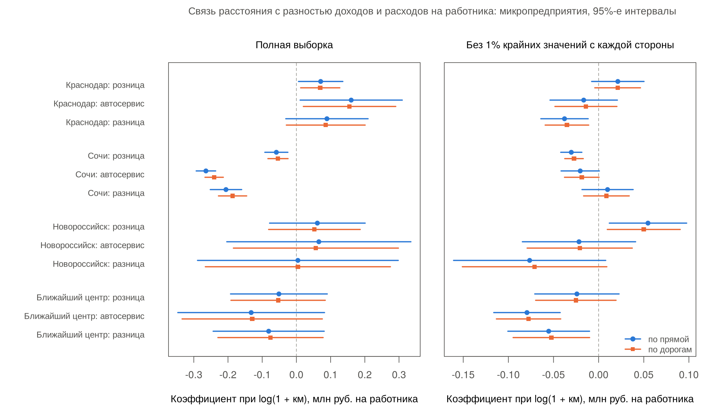
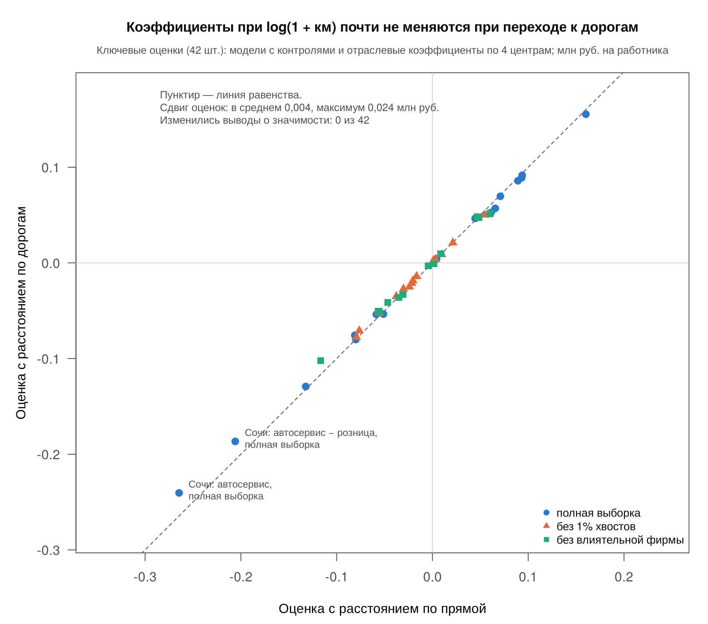
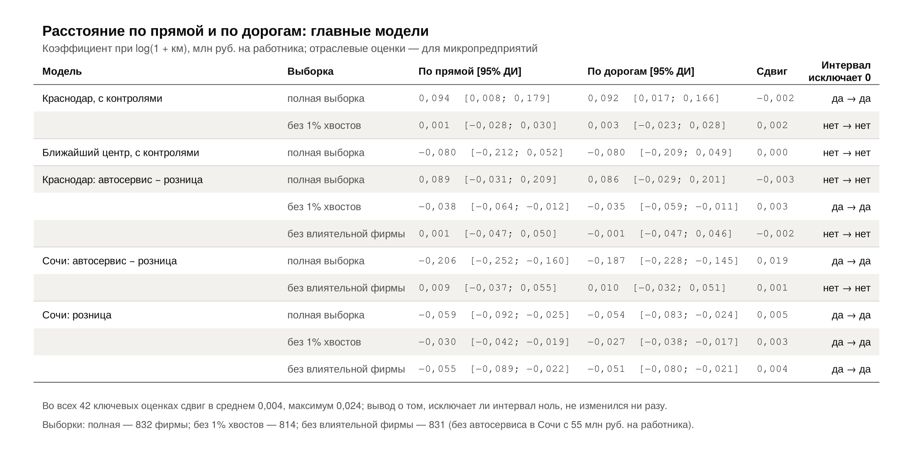

# Регрессии с расстоянием по дорогам: сравнение с расстоянием по прямой

## Что сделано

Все спецификации из [`scripts/regression_profit.R`](../scripts/regression_profit.R) (описание — [`regression_profit_RU.md`](regression_profit_RU.md)) оценены повторно с расстоянием **по автомобильным дорогам** вместо расстояния по прямой. Обе версии каждой модели оцениваются в одном скрипте на **одной и той же выборке**, поэтому различие между ними вызвано только способом измерения расстояния. Базовый скрипт и его результаты не изменялись.

Скрипт: [`scripts/regression_profit_road.R`](../scripts/regression_profit_road.R). Запуск из корня проекта, нужен только базовый R:

```r
source('scripts/regression_profit_road.R')
```

## Данные и выборка

- **Зависимая переменная** — та же, что в базовых моделях: `(revenue - expenditure) / employees_count / 1e6`, разность доходов и расходов на работника, млн руб. в год. Выбор основного показателя ещё согласуется командой ([TASKS.md](../TASKS.md), задача 1); здесь он сохранён для сопоставимости с базовыми результатами.
- **Расстояние по дорогам** — длина кратчайшего по времени автомобильного маршрута от населённого пункта регистрации до Краснодара, Сочи, Новороссийска и ближайшего из них по дорогам. Расчёт: OSRM по данным OpenStreetMap, 9 ноября 2026 года, [`scripts/road_distances.R`](../scripts/road_distances.R), кэш — [`data/road_distances.csv`](../data/road_distances.csv). В модели входит `ln_road_* = log(1 + км)`, как и для прямых расстояний.
- **Проверки дорожной переменной.** Пропусков и отрицательных значений нет. У фирм в самих центрах (238 в Краснодаре, 175 в Сочи, 30 в Новороссийске) расстояние равно 0 и по прямой, и по дорогам. Ни один маршрут дальше 5 км не короче 0,95 расстояния по прямой. Сдвиг координат при привязке к дороге не больше 173 м.
- **Общая выборка** — 832 фирмы в 143 населённых пунктах, та же, что в базовых моделях. Из 833 фирм итоговой таблицы исключена одна: в Чушке население равно нулю, его логарифм не определён. Из-за дорожных расстояний ничего не исключено. Журнал — [`results/profit_road_sample.csv`](../results/profit_road_sample.csv).

## Спецификации и проверки устойчивости

Спецификации те же, что в базовом скрипте: только расстояние до Краснодара; с контролями `auto`, `small`, `ln_settl_pop`; со взаимодействиями расстояния с отраслью и размером; ближайший центр; группы населения вместо логарифма. Каждый центр оценивается **отдельно** (расстояния до центров взаимосвязаны), со взаимодействиями, на трёх выборках:

| Выборка | Правило |
|---|---|
| `all` | Полная общая выборка, 832 фирмы — основная |
| `trimmed` | Без 1% крайних значений зависимой переменной с каждой стороны: от −2,565 до 9,203 млн руб., 814 фирм |
| `no_top_cook` | Без самой влиятельной фирмы — с наибольшим расстоянием Кука в модели, 831 фирма |

Самая влиятельная фирма во всех четырёх моделях центров и в обеих версиях расстояния одна и та же: автосервис в Сочи (ИНН 2366033379) с максимальным значением показателя, 55,2 млн руб. на работника. Это та же фирма, которую исключает базовая модель `sochi_without_max`.

Стандартные ошибки кластеризованы по населённому пункту (`settlement_id`) с поправкой CR1. Интервалы и p-значения — по t-распределению с числом степеней свободы G − 1 = 142.

## Проверка расчётов

- Прямые версии моделей в новом скрипте **в точности воспроизводят** базовые результаты: все 99 коэффициентов, стандартные ошибки, интервалы, p-значения, 24 отраслевые оценки, N, число кластеров и R² из `results/profit_regression_*.csv`.
- Кластерные ошибки совпадают с независимой реализацией `sandwich::vcovCL(type = "HC1")` до 5·10⁻¹³. Проверка выполняется в конце скрипта, если пакет `sandwich` установлен.

## Результаты

Коэффициент при log(1 + км), млн руб. на работника; в скобках — 95%-й интервал. «10 → 100 км» — изменение показателя при росте расстояния с 10 до 100 км: коэффициент × log(101/11) ≈ коэффициент × 2,22. Отраслевые оценки относятся к микропредприятиям.

| Модель | Выборка | По прямой | По дорогам | 10 → 100 км, по дорогам |
|---|---|---|---|---|
| Краснодар, с контролями | полная | 0,094 [0,008; 0,179] | 0,092 [0,017; 0,166] | +0,20 |
| Краснодар, с контролями | без 1% хвостов | 0,001 [−0,028; 0,030] | 0,003 [−0,023; 0,028] | +0,01 |
| Ближайший центр, с контролями | полная | −0,080 [−0,212; 0,052] | −0,080 [−0,209; 0,049] | −0,18 |
| Краснодар: автосервис − розница | полная | 0,089 [−0,031; 0,209] | 0,086 [−0,029; 0,201] | +0,19 |
| Краснодар: автосервис − розница | без 1% хвостов | −0,038 [−0,064; −0,012] | −0,035 [−0,059; −0,011] | −0,08 |
| Краснодар: автосервис − розница | без влиятельной фирмы | 0,001 [−0,047; 0,050] | −0,001 [−0,047; 0,046] | 0,00 |
| Сочи: автосервис − розница | полная | −0,206 [−0,252; −0,160] | −0,187 [−0,228; −0,145] | −0,41 |
| Сочи: автосервис − розница | без влиятельной фирмы | 0,009 [−0,037; 0,055] | 0,010 [−0,032; 0,051] | +0,02 |
| Сочи: розница | полная | −0,059 [−0,092; −0,025] | −0,054 [−0,083; −0,024] | −0,12 |
| Сочи: розница | без 1% хвостов | −0,030 [−0,042; −0,019] | −0,027 [−0,038; −0,017] | −0,06 |
| Сочи: розница | без влиятельной фирмы | −0,055 [−0,089; −0,022] | −0,051 [−0,080; −0,021] | −0,11 |

Полная таблица по всем центрам, группам и выборкам — [`results/profit_road_comparison.csv`](../results/profit_road_comparison.csv), график — [`figures/08_road_vs_straight_coefficients.png`](../figures/08_road_vs_straight_coefficients.png). Шкалы двух панелей графика различаются.



Для слайдов есть ещё два наглядных сравнения ([`scripts/plot_road_vs_straight.R`](../scripts/plot_road_vs_straight.R), строит их из сохранённых результатов):

- [`figures/09_road_vs_straight_scatter.png`](../figures/09_road_vs_straight_scatter.png) — все 42 ключевые оценки: по прямой (ось X) против по дорогам (ось Y). Точки лежат на линии равенства; заметнее всего сдвигаются две оценки по Сочи на полной выборке, которые создаёт одна фирма.
- [`figures/10_road_vs_straight_table.png`](../figures/10_road_vs_straight_table.png) — таблица главных моделей: обе оценки с интервалами, сдвиг и «исключает ли интервал ноль» до и после перехода к дорогам. Та же таблица текстом — [`results/profit_road_comparison_slide.csv`](../results/profit_road_comparison_slide.csv) (например, для `knitr::kable` в Quarto).





## Тезисы для слайдов

1. **Переход к расстоянию по дорогам почти не меняет результаты.** В 42 ключевых оценках коэффициент сдвигается в среднем на 0,004 (максимум — на 0,024, автосервис в модели Сочи). Ни в одной оценке не изменилось, исключает ли 95%-й интервал ноль; R² меняется в четвёртом знаке. Причина: на уровне населённых пунктов log(1 + км) по дорогам и по прямой коррелируют на 0,98–0,99, а 443 из 832 фирм зарегистрированы в самих центрах, где оба расстояния равны нулю. Дороги заметно длиннее прямой в основном на горном побережье (Адербиевка, Геленджик, Красная Поляна, Пшада — в 1,9–2,3 раза), но это меняет порядок пунктов по удалённости лишь немного.
2. **Связь с расстоянием до Краснодара держится на крайних значениях.** В модели с контролями рост расстояния с 10 до 100 км соответствует примерно +0,20 млн руб. на работника, интервал не включает ноль. Без 1% крайних значений с каждой стороны оценка близка к нулю: 0,003 [−0,023; 0,028].
3. **Отраслевые различия не устойчивы.** Разница «автосервис − розница» по расстоянию до Краснодара в полной выборке положительная, но интервал включает ноль; без хвостов — отрицательная; без одной самой влиятельной фирмы — нулевая. Утверждать, что связь различается между отраслями, данные не позволяют.
4. **Крупная отрицательная разница для Сочи создаётся одной фирмой** — автосервисом в Сочи с 55 млн руб. на работника. Без неё разница 0,010 [−0,032; 0,051]. Устойчив по знаку только коэффициент для розницы по расстоянию до Сочи: отрицательный во всех трёх выборках. Это одна из многих проверенных спецификаций, поэтому трактовать её нужно осторожно.
5. **Расстояние объясняет очень малую долю различий между фирмами** — R² всех моделей не выше 1,3%. Показатель на работника сильно разнороден (от −32 до +55 млн руб.). Результаты описывают условную связь за один год, а не причинное влияние.

## Ограничения дорожной переменной

- Маршруты построены по современной дорожной сети OpenStreetMap, а не по сети 2023 года; профиль автомобиля OSRM не учитывает пробки.
- Расстояние считается от точки населённого пункта регистрации; адрес регистрации может не совпадать с местом деятельности.
- Ближайший центр по дорогам у 39 фирм не совпадает с ближайшим по прямой; `nearest_center` в таблице относится к прямому расстоянию.

## Файлы результатов

| Файл | Содержимое |
|---|---|
| `results/profit_road_sample.csv` | Выборки, число фирм и пунктов, причины исключений, границы обрезки |
| `results/profit_road_coefficients.csv` | Все коэффициенты всех моделей: `distance` = `straight` / `road`, `sample` = `all` / `trimmed` / `no_top_cook`; кластерные ошибки, интервалы, p-значения. Переменная расстояния названа `ln_distance_<центр>` в обеих версиях |
| `results/profit_road_summary.csv` | N, число кластеров, R², исключённая фирма |
| `results/profit_road_centers.csv` | Коэффициент расстояния для розницы, автосервиса и их разница по каждому центру и выборке |
| `results/profit_road_comparison.csv` | Прямое и дорожное расстояние рядом, эффект 10 → 100 км — таблица для слайдов |
| `figures/08_road_vs_straight_coefficients.png` | График отраслевых коэффициентов по прямой и по дорогам |
| `figures/09_road_vs_straight_scatter.png` | Диаграмма рассеяния: все 42 ключевые оценки, по прямой против по дорогам |
| `figures/10_road_vs_straight_table.png` | Таблица главных моделей для слайда |
| `results/profit_road_comparison_slide.csv` | Та же таблица текстом, с форматированными числами |
